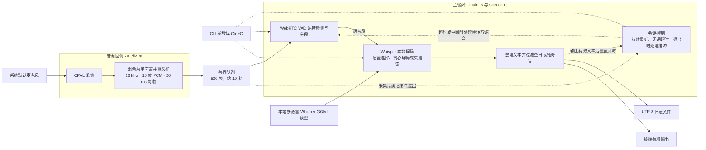

# rt-transcriber 中文使用与架构说明

rt-transcriber 是一个用 Rust 编写的实时语音转写命令行工具。它采集操作系统的默认麦克风，用本地 Whisper 模型识别中文或英文，并将每段结果输出到终端和 UTF-8 日志。音频在内存中处理，日志只保存文本。

## 安装和首次运行

编译需要支持 Rust 2024 Edition 的稳定版 Rust、CMake 和 C/C++ 工具链。macOS 需要安装 Xcode 命令行工具。Debian 或 Ubuntu 需要 `build-essential`、`libclang-dev`、`libasound2-dev` 和 `pkg-config`。

在项目根目录下载多语言 Base 模型并启动中文转写。

```sh
mkdir -p models
curl -fL --retry 3 \
  https://huggingface.co/ggerganov/whisper.cpp/resolve/main/ggml-base.bin \
  -o models/ggml-base.bin

cargo run --release -- --language zh
```

如果系统提示请求麦克风访问，请允许当前终端访问麦克风。程序默认持续监听，按 Ctrl+C 可退出。默认模型路径和日志路径均相对于运行命令时的工作目录。

## 使用 Large V3 Turbo

下载完整模型后，用 `--model` 选择它。以下示例固定使用中文识别，并将连续语音的分段上限设为 8 秒。

```sh
mkdir -p models
curl -fL --retry 3 \
  https://huggingface.co/ggerganov/whisper.cpp/resolve/main/ggml-large-v3-turbo.bin \
  -o models/ggml-large-v3-turbo.bin

cargo run --release -- \
  --model models/ggml-large-v3-turbo.bin \
  --language zh \
  --max-segment-seconds 8
```

完整模型约 1.5 GiB。若解码跟不上采集速度，可以试用约 547 MiB 的量化模型 `ggml-large-v3-turbo-q5_0.bin`，下载后将 `--model` 改为对应路径。 [whisper.cpp 模型列表](https://huggingface.co/ggerganov/whisper.cpp)

Apple Silicon Mac 可在本机终端启用 Metal，让 GPU 加速解码。

```sh
cargo run --release --features metal -- \
  --model models/ggml-large-v3-turbo.bin \
  --language zh --max-segment-seconds 8 --beam-size 1
```

## 参数与运行模式

| 参数 | 默认值 | 用途 |
| --- | --- | --- |
| `--language` | `auto` | `zh` 固定识别中文，`en` 固定识别英文，`auto` 每段自动检测语言。 |
| `--model` | `models/ggml-base.bin` | 指定本地多语言 Whisper GGML 模型。 |
| `--log-file` | `transcript.log` | 向指定文件追加转写文本。 |
| `--duration` | `forever` | `forever` 持续监听，`auto` 在一段时间内没有识别到有效文本时退出。 |
| `--timeout` | `30` | 自动模式下的超时秒数，须为正整数。 |
| `--max-segment-seconds` | `4` | 连续语音的分段上限，取值 1 至 20 秒。 |
| `--beam-size` | `1` | 取值 1 至 8。1 使用贪心解码，更大的值启用束搜索。 |

例如，使用 Base 模型进行中文转写，在 15 秒内没有识别到有效文本时自动退出。

```sh
cargo run --release -- --language zh --duration auto --timeout 15
```

自动模式从开始监听时计时，每次输出有效文本后重新计时。到期时会先尝试转写当前语音段。两种模式都可用 Ctrl+C 停止采集，并处理已经进入队列的音频和待转写片段。

如果连续讲话时句子经常在中间被截断，可以把分段上限提高到 8 秒。语音检测到停顿时仍可提前送出当前片段。如果常出现同音词替换，可试用 `--beam-size 5`。束搜索会在每步解码时保留多个候选，可能改善用词，也会增加解码开销。

## 架构图



可在支持 Mermaid 的编辑器中打开 [架构图源文件](docs/architecture.mmd)。

## 模块职责

- [`src/audio.rs`](src/audio.rs) 通过 CPAL 打开默认麦克风，在音频回调中完成单声道混合、重采样和分帧。回调非阻塞地投递音频帧，500 帧的有界队列为解码留出约 10 秒的积压空间。
- [`src/speech.rs`](src/speech.rs) 通过 WebRTC VAD 判断语音活动。出现约 400 毫秒连续非语音或达到分段上限时结束当前片段。只有累计至少 200 毫秒被判定为语音的片段才会送入 Whisper，以减少短促噪声引起的误转写。每个片段独立解码，程序汇总并整理该片段的文本。
- [`src/main.rs`](src/main.rs) 解析参数并协调采集、分段和解码。每段有效文本先追加到日志，再写入并刷新标准输出。错误与状态提示发送到标准错误。

## 常见问题

- **麦克风无法打开。** 确认系统声音设置中选中了可用的输入设备，并检查终端的麦克风权限。
- **模型无法加载。** 检查模型文件的下载是否完整、路径是否正确，并确认使用的是多语言 GGML 模型。
- **解码跟不上麦克风。** 尝试使用更轻量的量化模型，或将 `--beam-size` 调回 1。程序检测到缓冲区溢出时会报错退出。
- **有环境声时仍然自动退出。** `auto` 根据距上次输出有效文本的时间退出，环境声本身不会重置计时。

运行 `cargo test` 可检查重采样、停顿分段、分段上限和退出时的分段处理。

[English README](README.md)
